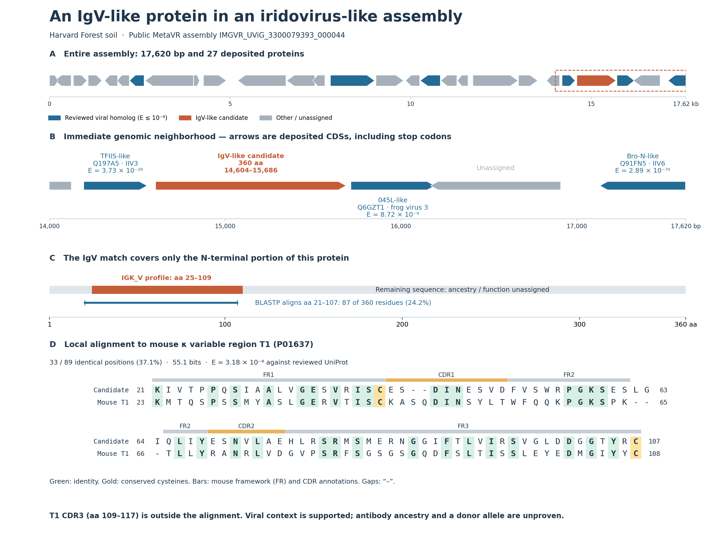

# The IgV-like candidate with viral flanks — 2026-11-16

**The match supports an immunoglobulin κ-variable-like domain, but does not identify an antibody gene or allele.** The strongest reviewed-protein match by bit score is the historical mouse sequence **T1**, UniProt **P01637 / KV5A5_MOUSE**. A nearly tied match is mouse **L6**, **P01638 / KV5A6_MOUSE**. The candidate has credible viral genomic context, but a novel natural antibody/TCR capture has not been established.

This follows the [reviewable follow-up plan](CANDIDATE_FOLLOWUP_PLAN.md) under [issue #1](https://github.com/timodonnell/bio-fishing-expeditions/issues/1).



[Vector PDF](figures/igv_candidate_context.pdf) · [SVG](figures/igv_candidate_context.svg) · [Plain-text alignment](results/metavr/lead_followup/alignment.txt) · [Exact alignment columns](results/metavr/lead_followup/alignment_columns.tsv)

## What sequence is this?

- Assembly: **IMGVR_UViG_3300079393_000044**, 17,620 bp, 27 deposited proteins.
- Candidate: **Ga0643767_0002625_14604_15686**, 360 amino acids; plus-strand CDS at 14,604–15,686 including its stop codon. The translated amino acids occupy 14,604–15,683.
- Sample: **HARV_035-O-20230704-COMP-DNA1**, Harvard Forest and Quabbin Watershed NEON soil metagenome, Massachusetts.
- Catalog classification: high viral confidence, one hallmark, geNomad score 0.9774, predicted Iridoviridae/Ranavirus. Estimated completeness is only 9.15%, and the assembly is classified low quality. Viral confidence and genome completeness describe different properties.

This is a public metagenome assembly, not a virus isolate with an experimentally established host or function. All 27 deposited proteins were verified against the assembly's translated sequence. Neither this translation check nor the catalog classification independently validates the assembly's read-level junctions.

## Which antibody does it match?

The original **IGK_V** HMM is a κ-variable-family profile, not an individual germline allele. It matches candidate residues **25–109**, with independent-domain E = **3.95 × 10⁻⁴** after correcting for the full MetaVR database size.

The independent candidate-specific reviewed-protein comparison gives:

| Reviewed sequence | Candidate residues | Reference residues | Identity | Bit score | E-value |
| --- | --- | --- | --- | ---: | ---: |
| Mouse T1, P01637 | 21–107 | 23–108 | 33/89 = 37.1% | 55.1 | 3.18 × 10⁻⁸ |
| Mouse L6, P01638 | 21–107 | 23–108 | 32/89 = 36.0% | 54.7 | 2.95 × 10⁻⁸ |

These E-values refer to the **576,073-protein reviewed UniProt 2026_04** comparison database, not the MetaVR search space. T1 ranks first by bit score, while L6 has a slightly smaller E-value. Calling T1 a uniquely identified donor would be misleading. Other matches include mouse, rabbit, human, and chicken variable-region sequences; the [top comparisons](results/metavr/lead_followup/top_reviewed_matches.tsv) are retained.

The current [UniProt P01637 record](https://www.uniprot.org/uniprotkb/P01637/entry) names it “Ig kappa chain V-V region T1,” links to **V00772 / CAA24150.1**, and supplies **no gene-name or allele field**. Its reference is a [1980 study of rearranged κ-chain genes in a mouse myeloma](https://doi.org/10.1038/287603a0). The record's sequence version remains 1 and exactly matches our frozen reference. T1 is a historical sequence label; our analysis has not mapped it to a modern IMGT germline allele, and has not assigned any such allele to the viral-context protein. Even a future germline assignment for the reference would not establish the candidate's donor gene from this short distant alignment.

## What does the alignment show?

The local alignment contains **89 positions**, including five gap positions, and covers **87/360 candidate residues (24.2%)**. It has 33 identities and 49 BLAST-positive substitutions. The two reference cysteines at **43 and 108** align identically with candidate cysteines **41 and 107**. This is compatible with an Ig-like domain, but is not specific proof of antibody ancestry.

The figure's FR/CDR bars are annotations of **mouse T1**, not a prediction of viral antigen-binding loops. The alignment spans reference framework regions and CDR1/CDR2, ending at residue 108. **T1's annotated CDR3 (109–117) and framework 4 lie outside the match.** Thus this comparison supplies no matching CDR3 or V–J-junction evidence. The remainder of the 360-aa candidate has not been assigned antibody ancestry by this analysis. We have not demonstrated a full antibody chain, antigen recognition, expression, or immune-evasion function.

## Why is viral context credible?

The immediate left gene at **14,195–14,554** matches the IIV3 transcription elongation factor S-II-like protein **Q197A5** (E = **3.73 × 10⁻²⁰**). The immediate right gene at **15,715–16,191** matches frog virus 3 protein **045L / Q6GZT1** (E = **8.72 × 10⁻⁹**). A further gene at **17,133–17,618**, on the opposite strand, matches IIV6 Bro-N protein **Q91FN5** (E = **2.89 × 10⁻⁷⁰**). Other assembly genes also match iridovirus proteins.

These independent homologies support a viral assembly neighborhood. They make this candidate more interesting than the host immunoglobulin loci found elsewhere in the catalog. They still do not discriminate a captured antibody domain from a more general viral Ig-superfamily protein, nor exclude an assembly chimera without read support. The precise predicted genus should not be treated as experimentally confirmed.

## Is it novel?

**A virus encoding an Ig-like protein is not a novel observation.** The [2004 Singapore grouper iridovirus genome paper](https://doi.org/10.1128/JVI.78.22.12576-12590.2004) already reported multiple Ig-like-domain proteins, including ORF028L, ORF029L, ORF031L, ORF033L, ORF035L, and ORF131R. That is a relevant precedent, not evidence that this candidate is homologous to those particular ORFs.

**This sequence is already public in MetaVR.** Exact-identifier web searches did not surface a candidate-specific publication, but such searches miss unindexed sequences and different accession names. The completed candidate-specific RefSeq viral BLAST comparison had no reported hit at E ≤ 0.01; that bounded negative does not establish sequence novelty across GenBank/nr or other metagenome catalogs.

**A newly recognized antibody/TCR acquisition remains unproven.** The defensible description is an uncharacterized **IgV-like protein in a likely viral assembly**, with antibody/TCR origin unresolved. A stronger claim needs broader homolog collection and phylogenetic discrimination against non-antibody Ig-superfamily proteins, plus validation of the assembled viral junctions. No functional or evolutionary novelty claim is made here.

The older nr request queried a **different related environmental sequence** (assembly 3300082506_000014), not this exact lead. NCBI returned **UNKNOWN** for that request on 2026-11-16; no results were recovered, and expiration is possible. A new request for this exact candidate, **RID FPRKZY1C014**, was submitted and was still **WAITING** at the last recorded poll. It contributes no completed evidence to the interpretation. Request parameters, query hashes, and timestamps are retained in [the request manifest](results/metavr/lead_followup/nr/remote_blast.json).

## Reproduction and validation

From the repository root, after restoring the frozen comparison database and the two pinned UniProt metadata inputs:

```bash
EXP=experiments/1_viral_antibody_tcr
"$EXP/work/venv/bin/python" "$EXP/scripts/acquire.py" "$EXP/config/acquisition_candidate_followup.json"
"$EXP/work/venv/bin/python" "$EXP/scripts/analyze_igv_lead.py"
python "$EXP/scripts/plot_igv_lead.py"
"$EXP/work/venv/bin/python" "$EXP/scripts/validate_igv_followup.py"
```

The analysis uses the original BLAST+ **2.12.0** database and parameters, adds aligned residues to its output, and asserts that the original score/coordinates are reproduced. It checks the aligned sequence slices, identity count, unchanged reference sequence, absent reference gene/allele field, and CDR3 exclusion. The [analysis manifest](results/metavr/lead_followup/analysis_manifest.json) records exact commands, binary/source/input hashes, and output hashes. The plot used Python **3.10.13** and Matplotlib **3.9.3** from the existing base environment; its exact environment string, data hash, source hash, and PNG/SVG/PDF hashes are in the [figure manifest](results/metavr/lead_followup/figure_manifest.json). No structural prediction or automatic allele call is hidden in the illustration.

The final [artifact validation](results/metavr/lead_followup/validation.json) passed **22 hash checks**, verified the plotted profile coordinates against the original scan, recomputed the conserved cysteine positions, and confirmed that the reference CDR3 is outside the alignment.
